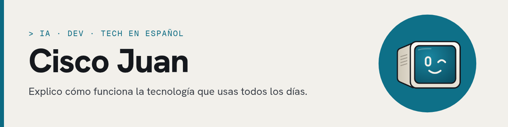

  

## Hola, soy Cisco Juan 👋

IA, dev y tech en español 🤖 Explico cómo funciona la tecnología que usas todos los días.

Soy desarrollador dominicano. Hablo de IA (modelos, agentes y cómo funcionan los LLM), de historia de la tecnología y de conceptos para devs que empiezan.

### Qué hago

- **PF Solutions**: desarrollo web y sistemas a medida para pymes.
- **Contenido sobre IA**: videos y posts que explican la tecnología sin hype.

### Stack

    
     

### Proyectos destacados

**[qa-tester](https://github.com/cisco-juan/qa-tester)**: plugin de Cursor para probar apps web como lo haría un usuario. Describes el flujo en lenguaje natural, y el agente arma los casos, navega con Playwright y deja un reporte. Si algo falla, el reporte trae capturas, video, trace, consola y requests HTTP.

**[linux-dynamic-island](https://github.com/cisco-juan/linux-dynamic-island)**: una Dynamic Island al estilo Apple para KDE Plasma 6 en Wayland. Es una píldora arriba al centro que se expande para mostrar notificaciones, la música que suena (MPRIS), un calendario y ajustes de volumen, brillo y Bluetooth. Está hecha con QML y C++ sobre layer-shell, así que no roba el foco.

### Dónde encontrarme

   
